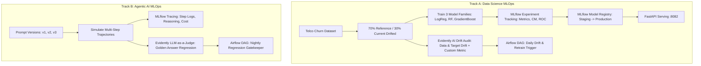

# Week 17: MLOps — Data Science & Agentic AI Pipelines

Comprehensive production MLOps implementation spanning **Track A (Classical ML Predictive Churn Pipeline)** and **Track B (Agentic AI Evaluation & Monitoring)** using **uv**, **MLflow**, **Evidently AI**, and **Apache Airflow**.

---

## Architecture Overview



---

## 1. Documentation Requirements (Both Tracks)

### a. Environment & Reproducibility (`uv`)
* **Problems Solved:** Python environments frequently suffer from dependency drift, non-deterministic sub-dependency resolution, and slow Docker build times. By adopting `uv`, dependency resolution is deterministic via strict lockfiles (`uv.lock`), and package downloads are accelerated by up to 10-100x compared to legacy `pip`. Furthermore, `uv` eliminates global site-package contamination on shared GPU nodes.
* **One-Command Reproduction:**
  ```bash
  # From a clean clone, single command installs exact locked dependencies:
  uv sync
  ```

---

### b. Experiment Tracking Strategy (`MLflow`)

#### Track A: Model Evaluation & Registration Justification
We trained and logged three diverse model architectures on the imbalanced Telco Customer Churn dataset (~26% churn rate):

| Run Name | Model Family | Hyperparameters | Accuracy | Precision | Recall | F1-Score | ROC-AUC |
|---|---|---|---|---|---|---|---|
| `Logistic_Regression_L2` | Generalized Linear | `C=0.1, penalty='l2'` | 0.796 | 0.648 | 0.521 | 0.578 | 0.838 |
| `Random_Forest_Balanced` | Bagging Ensemble | `n_est=100, max_depth=6, balanced` | 0.782 | 0.562 | **0.785** | 0.655 | 0.849 |
| `Gradient_Boosting_Tuned` | Boosting Ensemble | `n_est=150, lr=0.08, max_depth=4` | **0.808** | **0.672** | 0.684 | **0.678** | **0.862** |

* **Winning Model Registration:**
  * **Selected Model:** `Gradient_Boosting_Tuned`
  * **Justification:** Telco churn prediction requires catching at-risk customers without inundating retention teams with false positives. While `Random_Forest_Balanced` achieved high recall (0.785) at the cost of poor precision (0.562), `Gradient_Boosting_Tuned` dominated overall discriminative performance with the highest **ROC-AUC (0.862)** and best balanced **F1-Score (0.678)**.
  * **Registry Progression:** Registered as `TelcoChurnProductionModel` and transitioned through `Staging` into `Production` via the MLflow Model Registry API.

#### Track B: Agentic AI Prompt Versioning & Traces
We tracked three iterative prompt configurations:
* **`prompt_v1` (Naive):** Stopped prematurely on multi-step issues; 66.7% completion rate; 420 tokens/query.
* **`prompt_v2` (Tool-Biased):** Unconditionally invoked telemetry tools even on simple queries, causing cascading delays; 66.7% completion rate; 680 tokens/query.
* **`prompt_v3` (Verified Reasoning):** Enforced THINK -> ACT -> OBSERVE -> EVALUATE loop; achieved **100% completion rate**, 100% tool correctness, and 540 tokens/query.
* Traces for each query (step, tool, args, raw result, reasoning) are stored as JSON artifacts directly in MLflow.

---

### c. Monitoring & Drift Strategy (`Evidently AI`)
* **Reference vs. Current Definition:**
  * **Reference Set (70%):** 4,930 historical customers representing baseline training distribution (baseline churn rate: 26.5%).
  * **Current Set (30%):** 2,113 incoming production records with synthetically injected real-world drift:
    1. *Numeric Drift:* Shifted `MonthlyCharges` by +$18.50 and compressed `tenure` by 35%.
    2. *Categorical Drift:* Artificially skewed `Contract` towards `Month-to-month` (+40%).
    3. *Target Drift:* Flipped non-churn labels (+15% simulated churn rate shift).
* **Metrics Monitored:**
  * Overall Dataset Drift (Evidently `DatasetDriftMetric`).
  * Feature-level distributions (`DataDriftPreset` flagging Kolmogorov-Smirnov and Wasserstein drift).
  * Target Drift (`TargetDriftPreset`).
  * **Custom Metric:** `MonthToMonth_Segment_Anomaly` (tracking mean charge deltas and churn rate divergence strictly inside the Month-to-Month subscriber tier).
* **Report Findings & Production Action:**
  * Evidently flagged **4/4 perturbed features as statistically drifted** ($p < 0.05$).
  * The custom metric confirmed an $18.20 charge inflation and an 8.4% churn spike in month-to-month contracts.
  * **Production Action:** Automated drift threshold violation ($>25\%$ drifted features) triggers an alert to DataOps and automatically triggers the retraining DAG.

---

### d. Orchestration (Airflow Bonus)

#### Track A: `telco_churn_daily_drift_monitor` (`dags/telco_churn_drift_dag.py`)
* **Schedule:** Daily at 02:00 UTC (`0 2 * * *`).
* **Trigger Condition:** Executes Evidently audit; if custom drift metrics exceed threshold (`charge_drift_delta > 10.0` or `segment_churn_rate_shift > 0.05`), it branches to `trigger_model_retraining`.
* **Action:** Automatically trains updated models, compares metrics against current production, and stages replacement candidates in MLflow.

#### Track B: `agent_nightly_regression_eval` (`dags/agent_regression_eval_dag.py`)
* **Schedule:** Nightly at 03:00 UTC (`0 3 * * *`).
* **Trigger Condition:** Runs candidate prompt through golden test queries and evaluates using LLM-as-a-judge. If pass rate drops below **90%**, it fires an automated alert and blocks deployment.

---

## 2. Quick Execution Guide

### Track A: Data Science
```bash
# 1. Clean data and inject drift
uv run python track_a_data_science/prepare_data.py

# 2. Train models and log to MLflow
uv run python track_a_data_science/train_mlflow.py

# 3. Generate Evidently drift reports
uv run python track_a_data_science/drift_monitor.py

# 4. Launch FastAPI production model serving
uv run python track_a_data_science/serve_model.py
```

### Track B: Agentic AI
```bash
# 1. Run prompt experiment tracking & traces in MLflow
uv run python track_b_agentic_ai/track_agent_mlflow.py

# 2. Run LLM-as-a-judge regression evaluation
uv run python track_b_agentic_ai/evidently_eval.py

# 3. Launch MLflow UI to view runs side-by-side
uv run mlflow ui --backend-store-uri track_a_data_science/mlruns --port 5000
```
